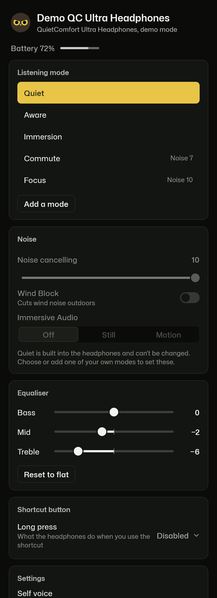
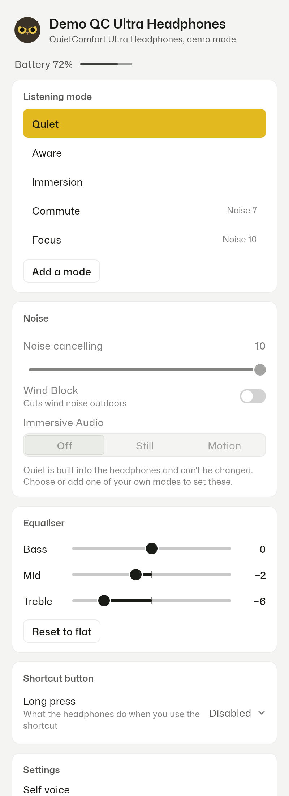

# Ruru

Ruru is a free, open-source app for Bose headphones on Windows, macOS, Linux, Android and iPhone.
It changes the same settings as the Bose app: listening modes, noise cancelling, Wind Block,
Immersive Audio, the equaliser, multipoint and the rest. There is no account, no cloud and no
analytics, and the Android app has no internet permission at all.

  
  

## Where it runs

| | Status |
|---|---|
| Windows 10 and 11 | Tested with QC Ultra Headphones (1st Gen). Sits in the tray with the battery level and a quick mode switch. |
| Android 9 and newer | Built from the same code; not yet tested on a phone. 2.4 MB. |
| macOS 12 and newer, Apple silicon | Built and started on GitHub's Macs; not yet tested with headphones. |
| Linux (BlueZ) | Built; not yet tested. Uses `bluetoothctl` to find the headphones. |
| iPhone | Demo mode works. Controlling the headphones needs one missing name, explained below. |

Every app has a demo mode that runs a simulated QC Ultra Headphones, so you can see it without
headphones.

## Headphones

Tested on real hardware, reading and changing settings: **QC Ultra Headphones (1st Gen)**,
firmware 1.6.7.

Expected to work, from Earshot's research and bosectl's captures: QC Ultra Headphones (2nd Gen),
QC Ultra Earbuds (1st and 2nd Gen), QC Headphones (1st and 2nd Gen), QC SC, QC45, QC SE,
QC Earbuds II, QC Earbuds (2020), Ultra Open Earbuds and Noise Cancelling Headphones 700.

If you have any of these, a report helps a lot: open an issue with the **Headset report**
template and paste the connection report from the bottom of the app.

## Install

Download the file for your system from [Releases](../../releases):

| System | File |
|---|---|
| Windows | `Ruru-<version>.msi` or `.exe` |
| macOS (Apple silicon) | `Ruru-<version>-macos-arm64.dmg` (not notarised) |
| Linux | `ruru_<version>_amd64.deb` or `ruru-<version>-1.x86_64.rpm` |
| Android | `ruru-<version>.apk` |
| iPhone | `Ruru-<version>.ipa` (unsigned, for your sideloading tool) |

The desktop apps aren't code-signed, so Windows SmartScreen and macOS Gatekeeper warn the first
time you open them. On Windows choose **More info**, then **Run anyway**. On macOS open
**System Settings > Privacy & Security** and choose **Open Anyway**. Each file's SHA-256 is
listed in `SHA256SUMS.txt` on the release.

Close the Bose app on the same device first: only one app can control the headphones at a time.
Ruru doesn't install firmware updates; use the Bose app for those.

## The iPhone

iOS doesn't let apps open a Bluetooth serial channel, which is how Ruru talks to the headphones
everywhere else. The QC Ultra Headphones (1st Gen) also don't answer Bose's protocol over
Bluetooth LE (checked on a real pair). That leaves Apple's accessory channel, which needs the
protocol name Bose uses there, and that name isn't public. iOS only lets an app see an
accessory whose name the app already lists, so Ruru tries the likely names; none has matched so
far, and the iPhone app says so plainly.

The name is in the `UISupportedExternalAccessoryProtocols` entry of the Bose app's `Info.plist`.
If you can read that entry (for example from the Bose app's IPA), please open an issue with it:
that one line is all the iPhone app needs.

## Privacy

Ruru talks only to your headphones. It sends nothing anywhere: no account, no analytics, no
crash reporting, no update checks. The connection report is text you copy yourself; it masks
Bluetooth addresses and leaves out the names of your other devices. See [PRIVACY.md](PRIVACY.md).

## Build it

You need JDK 21.

| What | Command |
|---|---|
| All tests | `./gradlew :core:protocol:jvmTest :core:dsp:jvmTest :core:session:jvmTest :app:shared:desktopTest` |
| Desktop app | `./gradlew :app:desktop:run` (add `--args=--demo` for demo mode) |
| Desktop installer | `./gradlew :app:desktop:packageMsi` (or `packageDmg`, `packageDeb`, `packageRpm`) |
| Android | `./gradlew :app:android:assembleRelease` (Android SDK required) |
| iPhone (on a Mac) | `./gradlew :app:shared:linkReleaseFrameworkIosArm64`, then `xcodegen` in `iosApp/` |

The code is Kotlin Multiplatform with Compose Multiplatform. `core/` holds the Bose protocol, the
session logic and the equaliser maths, shared by every app; `platform/` has one small Bluetooth
connection per system; `app/` has the screens and the apps. `tools/probe` checks a headset from a
Windows PC (read-only by default).

## Credits

Ruru's Bose protocol code, session logic, simulated headset and many of its tests come from
[Earshot](https://github.com/HellzYeahh/earshot) (MIT), ported to Kotlin Multiplatform and
corrected for the QC Ultra Headphones (1st Gen). Earshot built on
[bosectl](https://github.com/aaronsb/bosectl) and
[Quiet Rebellion](https://github.com/MadEyez/quietrebellion). Full list: [CREDITS.md](CREDITS.md).

## Not affiliated

Ruru is not affiliated with, endorsed by or supported by Bose Corporation. Bose and QuietComfort
are trademarks of Bose Corporation.

## Licence

MIT. See [LICENSE](LICENSE).
